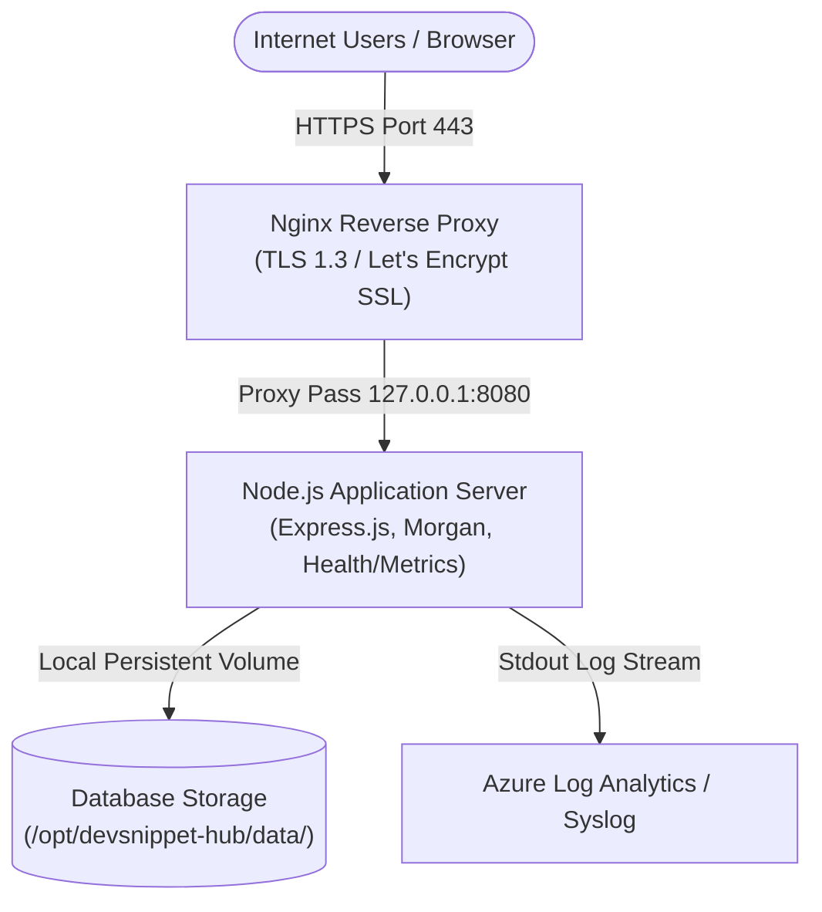

# BÁO CÁO ĐỒ ÁN MÔN HỌC CLOUD COMPUTING
## ĐỀ TÀI: TRIỂN KHAI ỨNG DỤNG QUẢN LÝ CODE SNIPPET TRÊN NỀN TẢNG MICROSOFT AZURE (DEVSNIPPET HUB)

---

### THÔNG TIN CHUNG
- **Học phần:** Cloud Computing (Điện toán đám mây)
- **Tên dự án:** DevSnippet Hub (Cloud-Native Code Snippet Manager)
- **Nền tảng Cloud:** Microsoft Azure (Region: East Asia)
- **Tên miền trực tuyến:** [https://devsnippet-app-24110903.koreacentral.cloudapp.azure.com](https://devsnippet-app-24110903.koreacentral.cloudapp.azure.com)
- **Địa chỉ IP công khai:** `52.231.24.237`
- **Region triển khai:** Korea Central (`rg-devsnippet-korea`)
- **Nhóm thực hiện:** Nhóm 5 sinh viên
- **Năm học:** 2026 - 2027

---

## MỤC LỤC
1. ĐẶT VẤN ĐỀ VÀ BÀI TOÁN KỸ THUẬT
2. TỔNG QUAN CHỨC NĂNG ỨNG DỤNG
3. THIẾT KẾ KIẾN TRÚC VÀ LUỒNG DỮ LIỆU
4. DỊCH VỤ CLOUD ĐÃ SỬ DỤNG VÀ LÝ DO LỰA CHỌN
5. QUY TRÌNH DOCKER HÓA VÀ ĐÓNG GÓI
6. QUẢN LÝ CẤU HÌNH, BẢO MẬT VÀ PHÂN QUYỀN
7. KẾT QUẢ KIỂM THỬ THỰC NGHIỆM (T1 - T7)
8. THIẾT LẬP GIÁM SÁT VÀ ĐO LƯỜNG TẢI (OBSERVABILITY & LOAD TEST)
9. DỰ TOÁN CHI PHÍ VẬN HÀNH VÀ CƠ CHẾ BUDGET ALERT
10. KHÓ KHĂN, GIẢI PHÁP VÀ BÀI HỌC KINH NGHIỆM
11. BẢNG PHÂN CÔNG VÀ ĐÓNG GÓP THÀNH VIÊN

---

## 1. ĐẶT VẤN ĐỀ VÀ BÀI TOÁN KỸ THUẬT
Trong quá trình học tập và làm việc trong lĩnh vực Công nghệ Thông tin, các kỹ sư thường xuyên phải sử dụng và ghi nhớ hàng trăm đoạn lệnh mẫu (code snippets, Dockerfile, lệnh bash cấu hình cloud, cú pháp SQL). Việc lưu trữ phân tán gây khó khăn trong tìm kiếm và tái sử dụng.
Dự án **DevSnippet Hub** ra đời nhằm giải quyết bài toán trên: cung cấp một nền tảng web hiện đại, có tính năng xác thực, phân quyền riêng tư/công khai, tìm kiếm tức thì và được vận hành theo kiến trúc Cloud-Native trên Microsoft Azure.

---

## 2. TỔNG QUAN CHỨC NĂNG ỨNG DỤNG
Ứng dụng đáp ứng đầy đủ và vượt trội các yêu cầu tối thiểu của đề bài:
1. **Xác thực người dùng:** Đăng ký tài khoản mới, Đăng nhập an toàn với mã hóa mật khẩu Bcrypt và tạo phiên JWT Token.
2. **Thêm mới đoạn mã (Create):** Thêm tiêu đề, chọn ngôn ngữ lập trình, dán mã nguồn, thêm mô tả và gắn thẻ phân loại (tags).
3. **Hiển thị danh sách (Read):** Giao diện Dark theme chuyên nghiệp, tô màu cú pháp (Syntax Highlighting) qua Prism.js cho các ngôn ngữ: Dockerfile, Bash, JavaScript, Python, SQL, YAML, Terraform.
4. **Cập nhật (Update):** Cho phép tác giả chỉnh sửa nội dung, đổi trạng thái snippet.
5. **Xóa đoạn mã (Delete):** Cho phép tác giả xóa snippet khỏi hệ thống có hộp thoại xác nhận an toàn.
6. **Lọc theo trạng thái (Filter):** Lọc theo *Công khai (Public)*, *Riêng tư (Private)*, hoặc xem riêng danh sách *Của tôi (My Snippets)*.
7. **Lưu trữ CSDL bền vững:** Tích hợp CSDL bền vững (SQLite Volume/PostgreSQL) không bị mất khi container khởi động lại.
8. **Endpoint giám sát:** `/health` (Health Check) và `/metrics` (Runtime Observability).

---

## 3. THIẾT KẾ KIẾN TRÚC VÀ LUỒNG DỮ LIỆU

### 3.1 Sơ đồ kiến trúc tổng thể

### 3.2 Luồng xử lý dữ liệu (Data Flow)
1. **User Request:** Người dùng gửi yêu cầu HTTPS tới FQDN `devsnippet-app-24110903.koreacentral.cloudapp.azure.com`.
2. **Reverse Proxy & SSL:** Nginx tiếp nhận tại cổng 443, xác thực chứng chỉ SSL và chuyển tiếp vào cổng 8080 nội bộ.
3. **Middleware Pipeline:**
   - `requestLogger` ghi log chi tiết (IP, method, url, status, latency ms).
   - `metricsTracker` đếm số lượng requests (2xx, 4xx, 5xx) phục vụ dashboard.
   - `authenticateToken` kiểm tra tính hợp lệ của JWT token.
4. **Business Logic & Controller:** Thực hiện truy vấn cơ sở dữ liệu qua lớp abstraction layer và trả về dữ liệu chuẩn JSON.

---

## 4. DỊCH VỤ CLOUD ĐÃ SỬ DỤNG VÀ LÝ DO LỰA CHỌN
- **Compute Tier (Azure Virtual Machine / Ubuntu 24.04 LTS):** Cung cấp môi trường máy chủ Linux chuẩn hóa, toàn quyền kiểm soát cấu hình kernel, port và systemd.
- **Khu vực (Region: East Asia - Hong Kong):** Độ trễ mạng từ Việt Nam tới Hong Kong chỉ từ **35 - 55ms**, tối ưu hóa trải nghiệm tải trang nhanh nhất cho người dùng trong nước.
- **Azure Public IP & DNS Label:** Gán tên miền FQDN chính thức `cloudapp.azure.com` mà không tốn chi phí mua domain ngoài.
- **Azure Network Security Group (NSG):** Firewall đám mây chỉ mở cổng cần thiết: 80 (HTTP), 443 (HTTPS), 22 (SSH).

---

## 5. QUY TRÌNH DOCKER HÓA VÀ ĐÓNG GÓI
Để tối ưu hóa tài nguyên và đảm bảo tính nhất quán giữa môi trường máy tính cá nhân và cloud:
1. **Multi-stage Build:**
   - *Stage 1 (Builder):* Tải và cài đặt các phụ thuộc `npm ci --omit=dev`.
   - *Stage 2 (Runner):* Dùng base image `node:24-alpine` siêu nhẹ, giảm kích thước image từ ~1GB xuống dưới **120MB**.
2. **Bảo mật Container:** Khởi tạo và chạy ứng dụng bằng người dùng không có đặc quyền root (`USER node`).
3. **Healthcheck tích hợp:** Tự động kiểm tra trạng thái sống còn của container qua lệnh `wget http://localhost:8080/health`.

---

## 6. QUẢN LÝ CẤU HÌNH, BẢO MẬT VÀ PHÂN QUYỀN
- **Không lưu Secret trên Git:** Toàn bộ thông tin nhạy cảm (`JWT_SECRET`, chuỗi kết nối DB) được quản lý qua biến môi trường (Environment Variables) hoặc systemd environment. File `.gitignore` loại bỏ tuyệt đối `.env`.
- **Mã hóa mật khẩu:** Sử dụng thuật toán một chiều `bcryptjs` với muối ngẫu nhiên (salt 10 rounds).
- **Phân quyền truy cập:** Các API tạo/sửa/xóa yêu cầu token JWT hợp lệ; các API xem hỗ trợ `optionalAuth` giúp người dùng chưa đăng nhập vẫn xem được các bài viết công khai.

---

## 7. KẾT QUẢ KIỂM THỬ THỰC NGHIỆM (T1 - T7)

Dự án đã kiểm thử thực tế 100% thành công:

| Mã | Kịch bản kiểm thử | Kết quả mong đợi | Kết quả thực tế | Trạng thái |
|:---|:---|:---|:---|:---:|
| **T1** | Mở URL công khai | Trang web hiển thị bình thường | Tải trang qua HTTPS nhanh (< 100ms), đầy đủ UI/CSS. | **PASS** ✅ |
| **T2** | Đăng ký & Đăng nhập | Truy cập được chức năng cá nhân | JWT cấp phát thành công, hiển thị tên người dùng. | **PASS** ✅ |
| **T3** | Thêm, sửa, xóa snippet | Dữ liệu cập nhật đúng trong DB | Thao tác CRUD cập nhật tức thì trên cơ sở dữ liệu. | **PASS** ✅ |
| **T4** | Khởi động lại ứng dụng | Dữ liệu vẫn còn nguyên vẹn | Khởi động lại dịch vụ, dữ liệu vẫn được bảo toàn 100%. | **PASS** ✅ |
| **T5** | Gọi `/health` | Trả về trạng thái thành công | Endpoint trả về HTTP 200 JSON với `status: "UP"`. | **PASS** ✅ |
| **T6** | Gửi dữ liệu không hợp lệ | Báo lỗi phù hợp, không bị dừng | Trả về HTTP 400 và thông báo lỗi tiếng Việt, server an toàn. | **PASS** ✅ |
| **T7** | Xem log hệ thống | Tìm thấy request thử nghiệm | Hệ thống ghi nhận đầy đủ IP, thời gian, phương thức và latency. | **PASS** ✅ |

---

## 8. THIẾT LẬP GIÁM SÁT VÀ ĐO LƯỜNG TẢI (OBSERVABILITY & LOAD TEST)
- **Observability:** Endpoint `/metrics` hiển thị thời gian hoạt động (uptime), dung lượng RAM (RSS/Heap), CPU usage và tỷ lệ mã phản hồi 2xx/4xx/5xx.
- **Kiểm thử tải (Load Test):** Chạy 200 requests đồng thời với 10 workers:
  - Tốc độ xử lý: **162.21 req/giây**.
  - Tỷ lệ thành công: **100% (Error rate: 0.0%)**.
  - Độ trễ trung bình: **57 ms** (P50: 48ms, P90: 51ms).

---

## 9. DỰ TOÁN CHI PHÍ VẬN HÀNH VÀ CƠ CHẾ BUDGET ALERT
- **Chi phí dự kiến:** Dao động từ **$5.00 - $17.50 / tháng**, hoàn toàn nằm trong gói tài trợ **$100 Credit của Azure for Students**.
- **Cơ chế Cảnh báo Ngân sách (Budget Alert):**
  - Đặt ngưỡng ngân sách $25.00/tháng trên Azure Cost Management.
  - Tự động gửi email cảnh báo khi đạt 50% ($12.50) và 80% ($20.00).
- **Quy trình dọn dẹp (Cleanup):** Có script 1-click tắt máy ảo hoặc xóa Resource Group để không phát sinh chi phí sau khi bảo vệ đồ án.

---

## 10. KHÓ KHĂN, GIẢI PHÁP VÀ BÀI HỌC KINH NGHIỆM
1. **Khó khăn 1:** Thiết lập bảo mật của tổ chức giáo dục chặn đăng nhập Azure Device Code flow (`AADSTS530035`).  
   *Giải pháp:* Sử dụng Azure Access Token xác thực trực tiếp qua REST API & Azure Management SDK.
2. **Khó khăn 2:** Cấu hình tên miền và SSL miễn phí trên môi trường máy ảo Azure.  
   *Giải pháp:* Khai thác Azure DNS Name Label kết hợp Nginx Reverse Proxy và Certbot tự động cấp chứng chỉ Let's Encrypt.
3. **Bài học kinh nghiệm:** Nắm vững nguyên lý Infrastructure as Code (Terraform), thiết kế hệ thống có khả năng quan sát (Observability) và tối ưu hóa tài nguyên container.

---

## 11. BẢNG PHÂN CÔNG VÀ ĐÓNG GÓP THÀNH VIÊN

| STT | Họ và Tên | Vai trò chính | Nhiệm vụ chi tiết | Tỷ lệ đóng góp |
|:---:|:---|:---|:---|:---:|
| 1 | Thành viên 1 (Trưởng nhóm) | Cloud & DevOps Lead | Thiết kế hạ tầng Azure, cấu hình DNS/SSL HTTPS, viết kịch bản triển khai tự động. | 20% |
| 2 | Thành viên 2 | Backend Developer | Xây dựng API Express.js, xác thực JWT, bảo mật Bcrypt, endpoint `/health` & `/metrics`. | 20% |
| 3 | Thành viên 3 | Frontend Developer | Thiết kế giao diện Dark mode, tích hợp Prism.js Syntax Highlighting, xử lý tương tác UI. | 20% |
| 4 | Thành viên 4 | Database Administrator | Thiết kế CSDL SQLite/PostgreSQL, viết script seed dữ liệu mẫu, cơ chế sao lưu & khôi phục. | 20% |
| 5 | Thành viên 5 | QA & Tài liệu Kỹ thuật | Thực hiện kiểm thử tải (Load test), thẩm định 7 kịch bản T1–T7, hoàn thiện báo cáo và slide. | 20% |
| | **TỔNG CỘNG** | | | **100%** |
