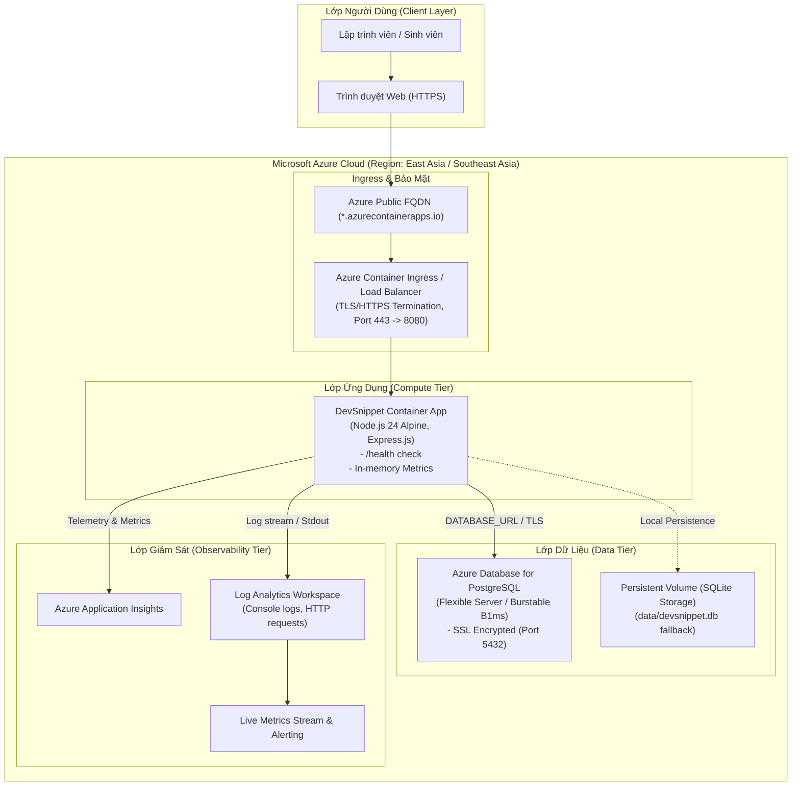

# SƠ ĐỒ KIẾN TRÚC VÀ THIẾT KẾ HỆ THỐNG CLOUD (DevSnippet Hub)

## 1. Tổng quan Kiến trúc

DevSnippet Hub được thiết kế theo mô hình **Cloud-Native Containerized Application**, tối ưu hóa cho nền tảng **Microsoft Azure**, đảm bảo tính mở rộng (scalability), độ tin cậy (reliability), chi phí thấp và bảo mật cao.

---

## 2. Luồng Xử Lý Dữ Liệu (Data Flow)

1. **Người dùng truy cập URL công khai:**
   - Yêu cầu HTTPS gửi tới Ingress Controller của Azure (Port 443).
   - Ingress giải mã TLS và chuyển tiếp traffic tới container cổng `8080`.
2. **Xác thực người dùng (Authentication Flow):**
   - Người dùng đăng nhập qua `/api/auth/login`.
   - Hệ thống mã hóa kiểm tra mật khẩu bằng `bcryptjs`.
   - Trả về token JWT có thời hạn và thiết lập cookie an toàn.
3. **Thao tác Quản lý Snippet (CRUD Flow):**
   - Thêm / Sửa / Xóa snippet được phân quyền thông qua middleware `authenticateToken`.
   - Xem snippet hỗ trợ `optionalAuth`: Người dùng chưa đăng nhập chỉ thấy các snippet `public`; người dùng đăng nhập sẽ thấy thêm snippet `private` của chính mình.
4. **Giám sát & Sức khỏe (Observability & Health):**
   - Azure định kỳ gọi `/health` mỗi 30 giây để kiểm tra tính sống còn (liveness/readiness probe).
   - Middleware `requestLogger` (Morgan) ghi lại chi tiết request vào stdout, Azure Log Analytics tự động thu thập.
   - Endpoint `/metrics` cung cấp thông số CPU, RSS memory, heap usage và phân loại mã trạng thái HTTP (2xx, 4xx, 5xx).
