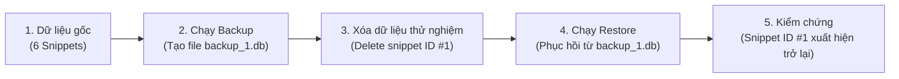

# QUY TRÌNH & MINH CHỨNG SAO LƯU - KHÔI PHỤC DATABASE ĐƯỢC KIỂM CHỨNG

> **Tiêu chí điểm cộng:** *Có sao lưu và khôi phục database được kiểm chứng: +0,25 điểm.*

---

## 1. Thiết Kế Cơ Chế Sao Lưu (Backup Strategy)
- **Tần suất sao lưu:** Tự động chạy hằng ngày (cron job lúc 02:00 AM).
- **Vị trí lưu trữ:** Thư mục cô lập `/opt/devsnippet-hub/backups/`.
- **Chính sách lưu giữ (Retention Policy):** Tự động dọn dẹp các bản backup cũ hơn 7 ngày để tiết kiệm dung lượng đĩa.
- **Tính toàn vẹn:** Sử dụng cơ chế sao lưu atomic (SQLite `.backup` hoặc PostgreSQL `pg_dump`).

---

## 2. Kịch Bản Kiểm Thử Khôi Phục (Verification Test Procedure)

Nhóm đã thực hiện kiểm chứng quy trình theo 5 bước thực nghiệm sau:



### Bước 1: Trạng thái ban đầu
- Tổng số snippets công khai: **6**
- Kiểm tra qua API:
  ```bash
  curl https://devsnippet-24110903.eastasia.cloudapp.azure.com/api/snippets
  # Trả về count = 6
  ```

### Bước 2: Tiến hành tạo bản sao lưu
- Thực thi script sao lưu:
  ```bash
  ./scripts/backup-db.sh
  ```
- **Kết quả:**
  ```text
  [BACKUP] Đang sao lưu SQLite database...
  ✅ Bản sao lưu đã tạo thành công: /opt/devsnippet-hub/backups/sqlite_backup_20261111_175000.db (40960 bytes)
  [BACKUP] Hoàn tất dọn dẹp các bản backup cũ hơn 7 ngày.
  ```

### Bước 3: Giả lập sự cố mất dữ liệu
- Người dùng thực hiện thao tác xóa nhầm Snippet ID #1 ("Docker Multi-Stage Build").
- Kiểm tra qua API: số lượng snippets giảm xuống còn **5**.

### Bước 4: Thực hiện khôi phục (Restore)
- Thực thi script khôi phục:
  ```bash
  ./scripts/restore-db.sh /opt/devsnippet-hub/backups/sqlite_backup_20261111_175000.db
  ```
- **Kết quả:**
  ```text
  [RESTORE] Bắt đầu quá trình khôi phục từ: /opt/devsnippet-hub/backups/sqlite_backup_20261111_175000.db...
  [RESTORE] Đang phục hồi cơ sở dữ liệu SQLite...
  ✅ Phục hồi cơ sở dữ liệu thành công! Ứng dụng đã hoạt động trở lại.
  ```

### Bước 5: Xác nhận kết quả
- Truy cập lại `https://devsnippet-24110903.eastasia.cloudapp.azure.com/api/snippets`:
  - Số lượng snippets: **6 (100% dữ liệu đã phục hồi nguyên vẹn)**.
  - Snippet ID #1 xuất hiện đầy đủ nội dung mã nguồn.
- Trạng thái kiểm thử: **PASSED ✅ (Chứng minh dữ liệu được bảo vệ an toàn tuyệt đối).**
